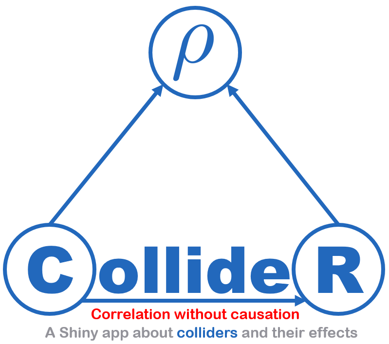

```{=html}
<div id="top"></div>
<a class="skip-link" href="#main">Saltar al contenido</a>
<header class="site-header"><div class="nav-wrap">
<a class="brand" href="../../index.html" aria-label="Causality Lab · Inicio"><span class="brand-wordmark" aria-hidden="true"><span class="brand-name">Causality<span>Lab</span></span><span class="ugr-affiliation"></span></span></a>
<button class="menu-toggle" aria-controls="main-nav" aria-expanded="false" aria-label="Abrir menú"><span></span><span></span></button>
<nav id="main-nav" aria-label="Navegación principal"><a href="../../index.html#about">Acerca del grupo</a><a href="../../index.html#research">Investigación</a><a href="../../index.html#resources">Formación</a><a href="../../index.html#publications">Publicaciones</a><a href="../../index.html#talks">Charlas</a><a href="../../index.html#software">Software</a><a href="../../index.html#books">Libros</a><a href="../../index.html#team" aria-current="page">Equipo</a><a class="nav-contact" href="../../index.html#contact">Contacto</a><div class="language-switch" role="group" aria-label="Seleccionar idioma"><span class="language-option is-current" lang="es" aria-current="page" aria-label="Español, idioma actual" title="Español"></span><a class="language-option" href="../../../team/eliezer-pita/index.html" lang="en" hreflang="en" aria-label="Cambiar a inglés" title="English"></a></div></nav>
</div></header>
<main id="main"><section class="profile-intro profile-intro-standard wrap"><div class="profile-media"><figure class="profile-photo "></figure><div class="profile-role-band"><span>Investigador doctoral</span><div class="profile-links" role="group" aria-label="Perfiles y contacto"><a class="profile-icon-link" href="https://orcid.org/0009-0004-8380-3198" aria-label="Perfil de ORCID"></a><a class="profile-icon-link" href="https://scholar.google.es/citations?user=kuYj8zoAAAAJ&amp;hl=es&amp;oi=ao" aria-label="Perfil de Google Scholar"></a><a class="profile-icon-link" href="https://github.com/epita95" aria-label="Perfil de GitHub"></a><a class="profile-icon-link" href="https://www.linkedin.com/in/eliezer-pita/" aria-label="Perfil de LinkedIn"><svg viewBox="0 0 24 24" aria-hidden="true" fill="currentColor"><path d="M20.45 2H3.55C2.69 2 2 2.68 2 3.52v16.96c0 .84.69 1.52 1.55 1.52h16.9c.86 0 1.55-.68 1.55-1.52V3.52c0-.84-.69-1.52-1.55-1.52ZM7.93 18.74H4.98V9.19h2.95v9.55ZM6.45 7.89a1.71 1.71 0 1 1 0-3.42 1.71 1.71 0 0 1 0 3.42Zm12.29 10.85h-2.95v-4.65c0-1.11-.02-2.54-1.55-2.54-1.55 0-1.79 1.21-1.79 2.46v4.73H9.5V9.19h2.83v1.31h.04a3.1 3.1 0 0 1 2.79-1.53c2.98 0 3.58 1.96 3.58 4.5v5.27Z"/></svg></a><a class="profile-icon-link profile-icon-email" href="mailto:eliezerpita@correo.ugr.es" aria-label="Enviar correo"><svg viewBox="0 0 24 24" aria-hidden="true"><rect x="3" y="5" width="18" height="14" rx="2"/><path d="m4 7 8 6 8-6"/></svg></a></div></div><div class="profile-credentials"><div class="profile-appointment"><p class="profile-position">Estudiante</p><ul class="profile-affiliations"><li>Departamento de Estadística e Investigación Operativa, Universidad de Granada</li></ul></div></div></div><div><div class="profile-name" role="heading" aria-level="1">Eliezer Pita Zambrano</div><p class="profile-bio">Es científico de datos y estudiante de doctorado en Estadística Matemática y Aplicada en la Universidad de Granada. Es licenciado en Ingeniería Mecánica y cursó la maestría en Ingeniería Matemática en la Universidad Tecnológica de Panamá.</p><p class="profile-bio">Durante su formación de maestría estudió la adherencia de pacientes a ensayos clínicos mediante minería de secuencias, identificando patrones de comportamiento relacionados con la continuidad y el abandono de los participantes.</p><p class="profile-bio">En Panamá, ha colaborado en estudios sobre la prevalencia de la enfermedad renal crónica y participa en investigaciones sobre enfermedad renal poliquística y cáncer de mama, mediante el análisis de información procedente de informes de radiología.</p><p class="profile-bio">Su investigación doctoral se centra en la inferencia causal y la inferencia conforme, con especial interés en la cuantificación de la incertidumbre cuando se utilizan modelos de aprendizaje automático o muestras pequeñas. Su proyecto está dirigido por <a href="../miguel-luque/index.html">Miguel Ángel Luque Fernández</a>.</p></div></section><div class="profile-related-surface"><svg class="profile-wave profile-wave-top" viewBox="0 0 1440 80" preserveAspectRatio="none" aria-hidden="true" focusable="false"><path d="M0 16 C280 16 420 32 700 48 C980 64 1170 64 1440 64 L1440 80 H0 Z"/></svg><section class="section wrap section-tight profile-related"><div class="section-heading"><div><h2>Líneas relacionadas</h2></div></div><article class="research-area-detail" id="research-conformal-inference" role="region" tabindex="-1" aria-labelledby="research-conformal-inference-title"><div class="research-visual"></div><div class="research-area-copy"><h3 id="research-conformal-inference-title">Inferencia conforme para preguntas causales</h3><div class="research-area-body"><p>Métodos conformes para cuantificar la incertidumbre en estimandos causales, también en situaciones con aprendizaje automático o muestras pequeñas. Investigamos los supuestos y las condiciones bajo los cuales se puede garantizar la cobertura en muestras finitas.</p></div></div></article></section><svg class="profile-wave profile-wave-end" viewBox="0 0 1440 80" preserveAspectRatio="none" aria-hidden="true" focusable="false"><path d="M0 64 C280 64 470 64 740 48 C1010 32 1160 16 1440 16 L1440 80 H0 Z"/></svg></div></main>
<footer class="site-footer"><div class="wrap footer-top"><a class="footer-brand" href="../../index.html"><span class="brand-name">Causality<span>Lab</span></span><span class="ugr-affiliation"></span></a><div><span class="eyebrow">GRANADA · SPAIN</span><p>Departamento de Estadística<br>e Investigación Operativa<br>Universidad de Granada</p></div><div class="footer-map"><div class="footer-map-visual"><a class="footer-map-view" href="https://maps.app.goo.gl/WQ4gs3aWyrLATWmR8" aria-label="Abrir la ubicación en Google Maps"></a><a class="footer-map-credit" href="https://www.openstreetmap.org/copyright">© OpenStreetMap contributors</a></div><a href="https://maps.app.goo.gl/WQ4gs3aWyrLATWmR8">Ver en Google Maps</a></div></div><div class="wrap footer-bottom"><span>© 2026 Causality Lab</span><span>Inferencia causal · Bioestadística · Epidemiología</span><a href="#top">Volver arriba ↑</a></div></footer>
```
